# RodApp Híbrido

> ## 🎥 Video demostrativo
> **[▶ Ver el video de la aplicación (Web + Android)](PEGAR_AQUI_EL_ENLACE_DEL_VIDEO)**
>
> En el video se muestra: ejecución en el navegador (`npm start`), ejecución en Android
> (emulador / dispositivo real), inicio de sesión (JWT y Google), consumo de APIs de terceros
> y el CRUD operativo.

**Aplicación híbrida para la gestión de motocicletas** (garaje, documentos SOAT y
Tecnomecánica, combustible, mantenimiento, mapa con rutas y clima). Un único código base
que corre como **web** y como **app Android** gracias a Capacitor.

Proyecto final — **Desarrollo de Aplicaciones Móviles Híbridas**
Fundación Universitaria Compensar · Ingeniería de Software · VII semestre · Corte 3

---

## 1. Identificación del equipo

| | |
|---|---|
| **Título de la solución** | RodApp Híbrido — gestión integral de motocicletas |
| **Integrante 1** | _Nombre completo_ |
| **Integrante 2** | _Nombre completo_ |
| **Integrante 3** | _Nombre completo_ |

### Alcance logrado frente al planteamiento inicial

RodApp nació como una app nativa Android y una versión web. En esta tercera iteración se
unificó en **una sola base de código híbrida** (Ionic + Angular + Capacitor) con backend en
Supabase. Frente al planteamiento inicial se logró:

- Autenticación completa (registro, login, recuperación de contraseña, Google, logout).
- Gestión del garaje: motos, SOAT, Tecnomecánica, combustible y mantenimiento, con
  datos reales persistidos en Postgres.
- Alertas de vencimiento mediante notificaciones locales.
- Mapa con búsqueda de lugares, trazado de rutas y pronóstico del clima.
- Panel de administración (suspender / habilitar usuarios).
- Ejecución verificada en navegador y en Android.

---

## 2. Tecnologías

| Capa | Tecnología |
|---|---|
| UI | **Ionic 8** (componentes standalone) + **Angular 18** |
| Capa nativa | **Capacitor 6** (Android) |
| Backend | **Supabase** (Auth + Postgres + RLS) — ver [`supabase/README.md`](supabase/README.md) |
| Estado | Angular **signals** |
| Mapas | **MapLibre GL** con teselas de OpenStreetMap |

### APIs y servicios de terceros

| Servicio | Uso en la app |
|---|---|
| **Google (OAuth)** vía Supabase | Inicio de sesión social |
| **OSRM** (`router.project-osrm.org`) | Cálculo de rutas entre origen y destino |
| **Nominatim** (OpenStreetMap) | Búsqueda de direcciones y lugares |
| **Open-Meteo** | Pronóstico del clima en la ruta |
| **OpenStreetMap** | Teselas del mapa |
| **Geolocalización** (`@capacitor/geolocation`) | Ubicación actual del usuario |

---

## 3. Cómo se cumple cada requisito

| Requisito de la entrega | Implementación | Dónde verlo |
|---|---|---|
| Login y registro con **JWT** | Supabase Auth emite un JWT (access token + refresh token) al iniciar sesión | `src/app/core/services/auth.service.ts`, `src/app/features/auth/` |
| **Acceso social** (Google) | OAuth con PKCE; en web por redirección, en Android por deep link `com.rodapp.hibrido://` | `auth.service.ts` (`loginWithGoogle`) |
| **Consumo de APIs** de terceros | Mapas, rutas, geocodificación y clima | `src/app/features/shell/map/` |
| **Sesión persistente** | `@capacitor/preferences` en nativo y `localStorage` en web | `src/app/core/storage/` |
| **Protección de vistas privadas** | `authGuard`, `guestGuard` y `adminGuard` | `src/app/core/guards/`, `app.routes.ts` |
| **Logout seguro** | `signOut` de Supabase: elimina la sesión y los tokens del almacenamiento | Pestaña *Perfil* |
| **CRUD operativo** | Documentos SOAT/RTM: crear, consultar, editar y eliminar; además altas de motos, combustible y mantenimiento | `src/app/features/shell/document-detail/`, `soat-form/`, `rtm-form/` |
| **Capacitor / Android** | `npx cap sync android` y ejecución nativa | carpeta `android/` |
| **Historial colaborativo** | Commits de los tres integrantes | pestaña *Commits* del repositorio |

### Seguridad

- Las contraseñas las gestiona Supabase Auth (hash + salt); nunca se guardan en tablas propias.
- Cada tabla tiene **Row Level Security**: un usuario solo accede a sus propios datos.
- En el código solo se incluye la clave pública (*anon / publishable*); no hay claves de servicio.

---

## 4. Evidencias

> Las capturas están en `docs/capturas/`. _Reemplazar los nombres si cambian._

### 4.1 Aplicación en el navegador (Web)

| Login | Inicio | Mapa |
|---|---|---|
| 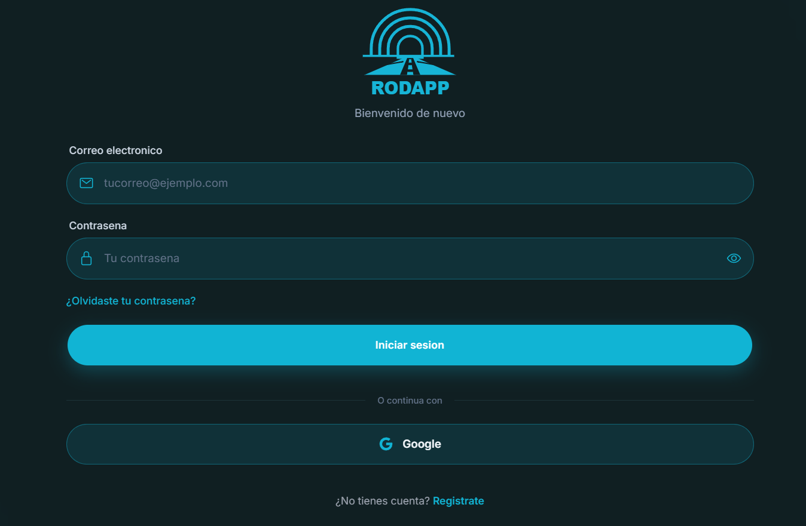 | 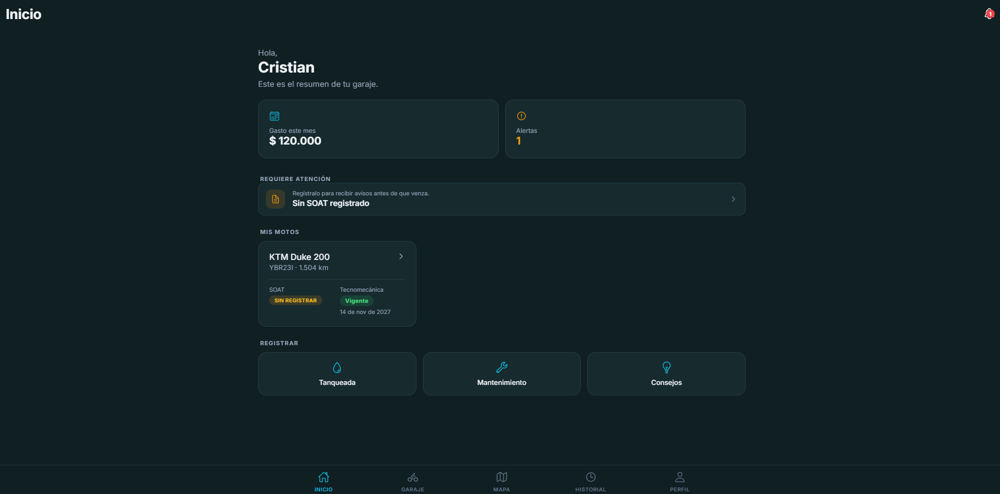 | 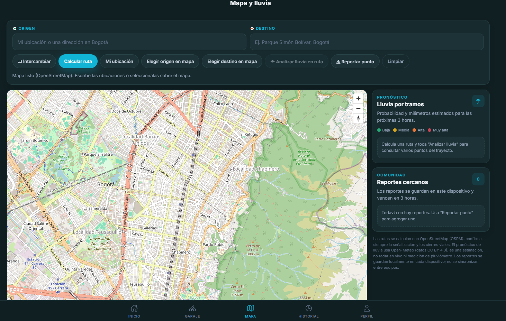 |

### 4.2 Aplicación en Android

| Login | Inicio | Mapa |
|---|---|---|
| 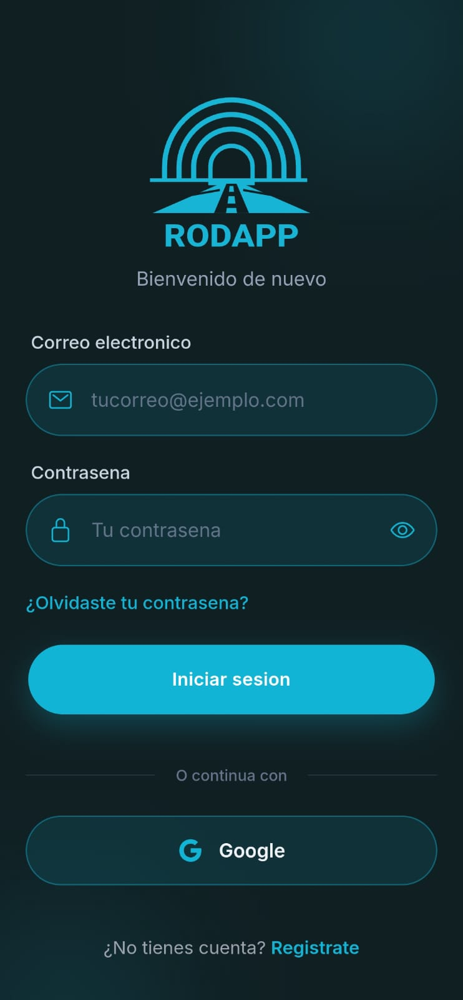 | 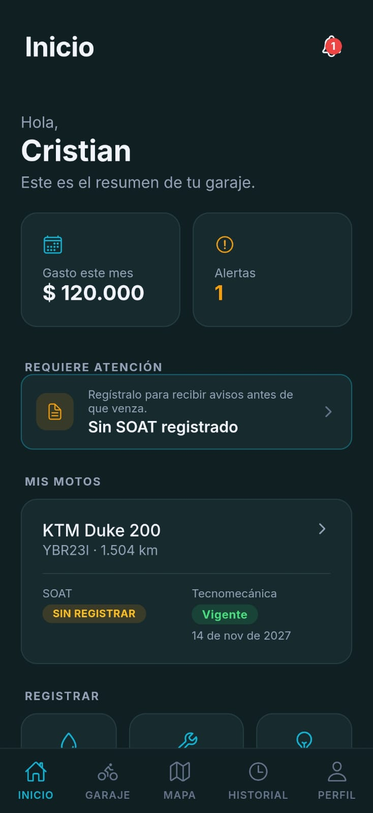 | 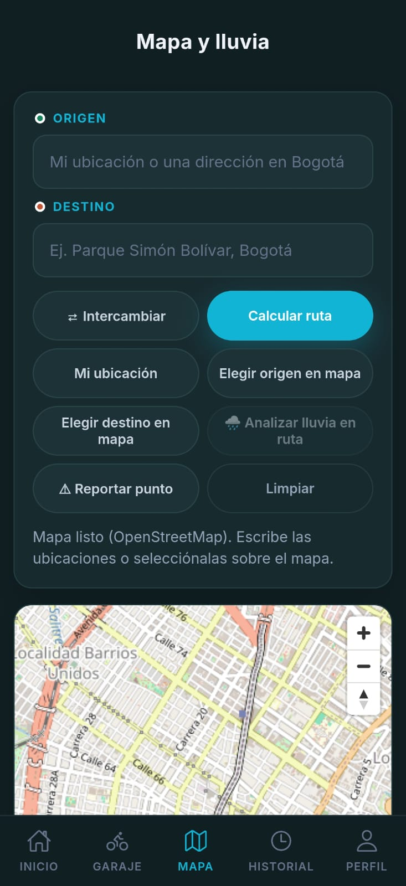 |

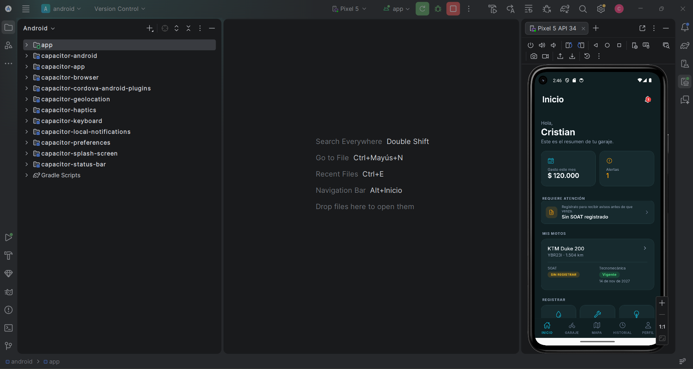

### 4.3 Pruebas de autenticación y de servicios

| Evidencia | Captura |
|---|---|
| Registro de usuario | 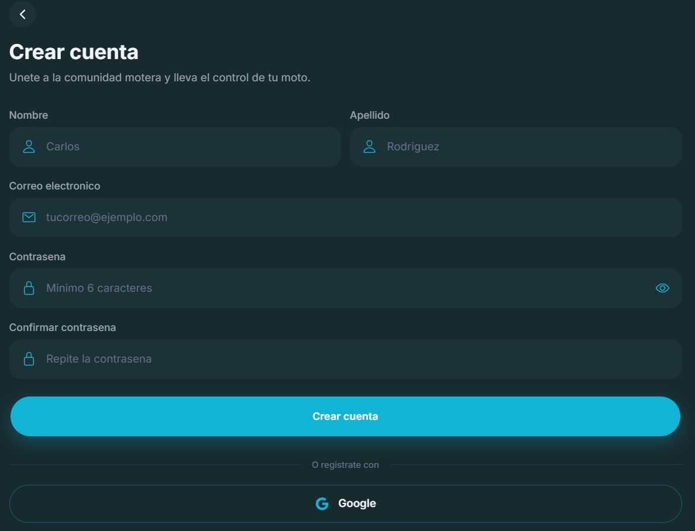 |
| Inicio de sesión con Google |  |
| Usuario creado en Supabase (*Authentication > Users*) | 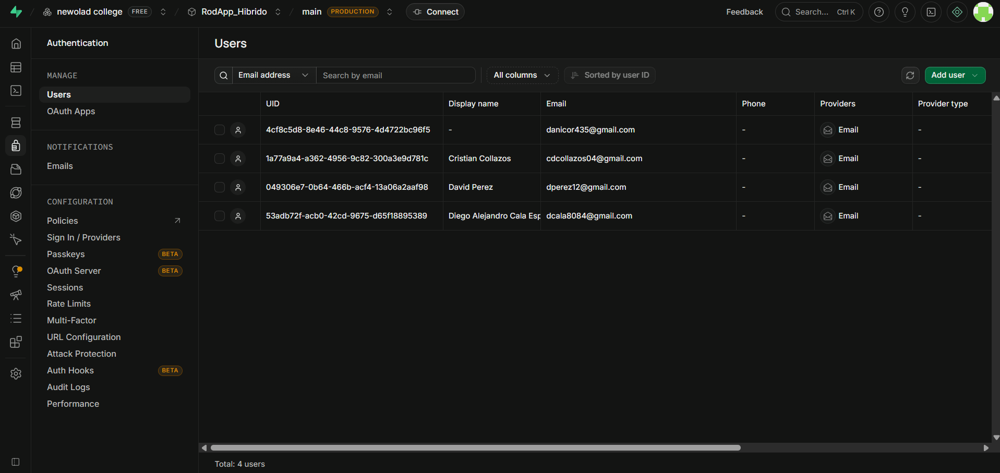 |
| Ruta calculada y clima (OSRM + Open-Meteo) | 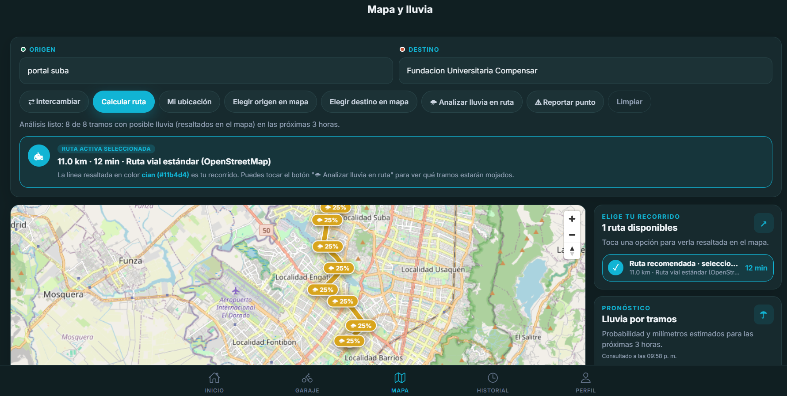 |
| CRUD de documentos (crear / editar / eliminar) | 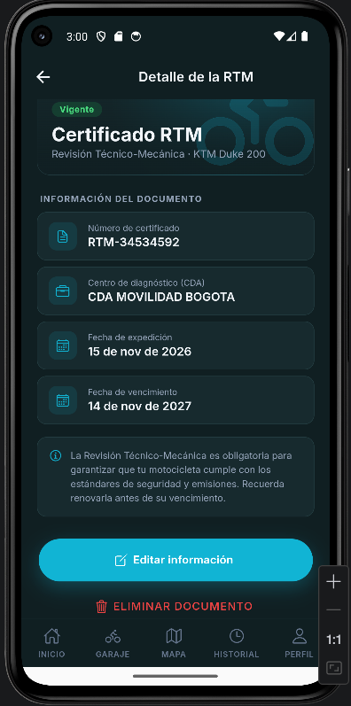 |

---

## 5. Instrucciones de despliegue y ejecución

### Requisitos

- **Node.js 20** (ver `.nvmrc`) y npm 10+
- **Android Studio** con un emulador (AVD) o un celular con depuración USB
- Git

### 5.1 Clonar e instalar

```bash
git clone https://github.com/newolad/RodApp_Hibrido.git
cd RodApp_Hibrido
npm install
```

### 5.2 Configurar el backend (Supabase)

1. Edita `src/environments/environment.ts` (y `environment.prod.ts`) con la **URL** y la
   clave pública *anon* de tu proyecto Supabase.
2. Aplica las migraciones de `supabase/migrations/` (9 tablas + RLS + trigger de perfil):

   ```bash
   npx supabase link --project-ref TU_PROJECT_REF
   npm run db:push
   ```

3. En **Authentication > URL Configuration** agrega estas *Redirect URLs*:
   - `http://localhost:8100/auth/callback`
   - `com.rodapp.hibrido://auth/callback`
   - `com.rodapp.hibrido://auth/restablecer`
4. En **Authentication > Sign In / Providers** habilita **Google** con las credenciales
   de Google Cloud.

> **Nota:** si *Confirm email* está activo, el registro envía un correo de confirmación. Con
> el correo por defecto de Supabase el envío es limitado; para pruebas se puede desactivar
> esa opción o configurar un SMTP propio.

### 5.3 Ejecutar en el navegador

```bash
npm start            # equivale a `ionic serve` → http://localhost:8100
```

### 5.4 Compilar

```bash
npm run build        # genera la carpeta /www
```

### 5.5 Ejecutar en Android

```bash
npm run build
npx cap sync android     # copia /www y los plugins al proyecto nativo
npx cap open android     # abre Android Studio
```

En Android Studio espera el *Gradle sync*, elige el emulador o el dispositivo y presiona ▶.
Atajo equivalente: `npm run android`.

El `AndroidManifest.xml` ya incluye:

- el *intent-filter* del deep link `com.rodapp.hibrido://auth` (retorno del login con Google);
- los permisos de **ubicación** y de **notificaciones**.

---

## 6. Estructura del código

```
src/app/
├── core/                      # Servicios singleton, sin UI
│   ├── models/                  # Interfaces de dominio
│   ├── services/                # supabase, auth, motos, admin, notificaciones…
│   ├── storage/                 # Adaptador de sesión (web / nativo)
│   └── guards/                  # authGuard, guestGuard, adminGuard
├── shared/                    # Componentes, iconos y utilidades reutilizables
└── features/
    ├── auth/                    # login · registro · recuperar · callback OAuth
    ├── admin/                   # panel de administración de usuarios
    └── shell/                   # tabs: inicio · garaje · mapa · historial · perfil
                                 # + formularios (moto, SOAT, RTM, combustible, mantenimiento)
supabase/                      # migraciones SQL, configuración y funciones
android/                       # proyecto nativo generado por Capacitor
```

---

## 7. Limitaciones conocidas y trabajo futuro

- El servidor público de OSRM y Nominatim son de uso moderado; en producción conviene un
  servidor propio o un proveedor de pago.
- Versión iOS no probada (no se dispuso de macOS).
- Pruebas automáticas limitadas.

---

## 8. Documentación adicional

- [`supabase/README.md`](supabase/README.md) — esquema de base de datos y políticas RLS.
- [`AVANCES.md`](AVANCES.md) — registro de avances del proyecto.
- [`CONTRIBUTING.md`](CONTRIBUTING.md) — flujo de ramas y guía para colaborar.